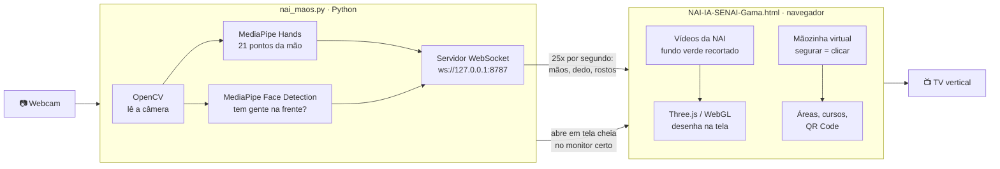

# Como a NAI foi feita

Este documento conta **como o projeto nasceu, como ele funciona por dentro e quais decisões foram tomadas**,
inclusive as ideias que não deram certo. Serve para a turma de Desenvolvimento de Sistemas estudar, mexer e melhorar.

---

## 1. A ideia

Para o evento **Mundo SENAI**, a unidade SENAI Gama queria algo que chamasse a atenção de quem passa:
uma **TV grande em pé** com a **NAI**, "a inteligência artificial do SENAI", que interage com o público
usando só uma **webcam**, sem tela de toque, teclado ou mouse.

O objetivo desta versão é **divulgar o curso de Aperfeiçoamento Profissional em Inteligência Artificial**
(40h, online) e as vagas gratuitas do SENAI Gama.

## 2. Como foi construída (linha do tempo)

O projeto foi feito em **iterações curtas**: testar no PC de verdade, ver o que falhava e ajustar.
O código foi escrito em conversa com uma IA generativa (Claude). O Diego descrevia o que queria, testava
e trazia o resultado de volta (prints, erros, "ficou estranho aqui"), e a IA ajustava o código.

| Etapa | O que foi tentado | Resultado |
|---|---|---|
| 1 | Avatar estilo anime que acena e **segue a pessoa com os olhos**, com câmera frontal e traseira | Funcionou, mas o movimento ficava discreto demais na TV |
| 2 | NAI **dançando** e trocando de uniforme por área de curso (vídeos do Gemini) | ❌ Abandonado: os vídeos gerados não ficaram bons |
| 3 | NAI falando em **Libras** (VLibras e vídeos gerados no Google Flow) | ❌ Abandonado: a IA de vídeo não gerou os sinais corretamente |
| 4 | **Conversa por voz**: o visitante fala e a NAI responde (Groq, depois Azure OpenAI) | ❌ Abandonado: no barulho de um evento não ficou confiável |
| 5 | NAI fala em **5 idiomas** e a pessoa escolhe **mostrando de 1 a 5 dedos** | ✅ Virou a versão **NAI CIL** (escola de inglês) |
| 6 | Contar dedos **no navegador** ficou lento e impreciso | ➡️ Criado o **programa Python** separado para a câmera |
| 7 | Contar dedos confundia as pessoas | ➡️ Trocado por uma **mãozinha virtual** (apontar e segurar) |
| 8 | Versão **Cursos**: fala única e lista de cursos por área (edital PSGR 04/2026) | ✅ |
| 9 | Versão **IA** (esta): igual à de Cursos, com o curso de IA em destaque e QR Code de inscrição | ✅ |

> 💡 **Lição:** boa parte do trabalho foi **jogar ideias fora**. Testar cedo no ambiente real
> (TV vertical, luz do evento, gente passando) mostrou o que funcionava melhor do que qualquer planejamento.

## 3. Arquitetura

São **duas partes** que conversam pela rede local do próprio PC:



### Por que dividir em Python + navegador?

- O **navegador** é ótimo para a parte visual: vídeo, animação, layout, fontes e QR Code.
- O **Python** com MediaPipe nativo reconhece as mãos **muito mais rápido e com mais precisão** do que a
  versão do MediaPipe que roda no navegador num notebook comum.
- Os dois conversam por **WebSocket**, um canal aberto em que o Python "empurra" dados para a página o tempo todo.
- **Plano B:** se o Python não estiver rodando, a página usa a câmera do próprio navegador (mais lento, mas funciona).

## 4. As peças, uma por uma

### 4.1 `nai_maos.py` — os "olhos" da NAI

| Função / classe | O que faz |
|---|---|
| `Maos.abrir_camera` | Tenta vários jeitos de abrir a câmera (DirectShow, Media Foundation, resoluções e MJPG) até achar um que não dê imagem preta |
| `Maos.run` | Laço principal: lê o quadro, espelha, reduz para 640 px, roda as mãos e, a cada 3 quadros, os rostos |
| `contar_dedos` | Conta dedos esticados pelos **ângulos das articulações** em 3D, o que funciona com a mão perto, longe ou girada |
| `Estabilizador` | Só troca o número quando ele se repete na maioria dos últimos quadros (evita "piscar") |
| `atender` / `transmitir` | Servidor WebSocket: manda o estado das mãos e dos rostos 25 vezes por segundo |
| `listar_monitores`, `encaixar_janela` | Usam a API do Windows (`ctypes` + `user32`) para descobrir as telas e colocar a NAI na TV certa |
| `monitor_escolhido` | Escolhe a tela da NAI: a escolhida com `T` (guardada pelo nome do monitor); se ela sumir, ou se nada foi escolhido, a TV (maior tela que não é a principal) |
| `energia_preparar` / `energia_restaurar` | Com `powercfg`, faz "fechar a tampa" não fazer nada e impede o PC e a tela de dormir; ao apertar `F`, devolve a ação original da tampa |
| `vigiar_telas` | A cada 2 s confere as telas; quando uma sai ou entra (tampa fechada), leva a NAI em tela cheia para a tela certa ou a reabre lá |
| `abrir_navegador` | Abre Firefox, Edge ou Chrome em **modo quiosque** (tela cheia, sem barra) |
| `menu_teclado` | As teclas F, R, T, I, C, N e J da janela preta |

Mensagem que o Python manda para a página (exemplo):

```json
{ "hands": [ { "count": 1, "tip": [0.52, 0.31], "x": 0.5, "y": 0.6, "up": true, "size": 0.18 } ],
  "faces": 2, "fps": 24.8, "cam": "c922 Pro Stream Webcam" }
```

`tip` é a ponta do indicador, de 0 a 1 na imagem. A página transforma isso na posição da mãozinha.

### 4.2 `NAI-IA-SENAI-Gama.html` — a NAI

Um único arquivo com HTML, CSS e JavaScript (cerca de 2.200 linhas, fora os vídeos). Seções principais:

| Seção no código | O que faz |
|---|---|
| `config` | Configurações salvas no `localStorage` do navegador (painel `S`) |
| `MODO 2D` | Avatar a partir de **uma imagem** deformada por um *vertex shader* (respiração, cabeça, balanço) |
| `NAI EM VÍDEO` | Toca os vídeos (parada em loop, aceno, boas-vindas) e **recorta o fundo verde** num *fragment shader* |
| `PROGRAMA PYTHON DAS MÃOS + TOQUE NO AR` | Conecta no WebSocket e transforma a ponta do dedo em cursor. **Segurar ~0,9 s** sobre um botão = clique |
| `ÁREAS E CURSOS + DIVULGAÇÃO AUTOMÁTICA` | Monta as áreas, a lista de cursos, o cartão do curso de IA e o QR Code. Decide quando a NAI fala sozinha |
| `câmeras` / `detecção de rostos` | Plano B pelo navegador (MediaPipe Tasks Vision) |
| `CONVERSA POR VOZ`, `IDIOMAS PELOS DEDOS`, `MODO 3D — VRM` | **Código das versões anteriores**, desligado nesta versão (veja a seção 6) |

**Recorte do fundo verde (chroma key).** Os vídeos foram gerados com a NAI na frente de um fundo verde.
O *shader* calcula, para cada pixel, o quanto ele é "mais verde que o resto" e deixa esse pixel transparente:

```glsl
float mx = max(c.r, c.b), gr = c.g - mx;              // quanto o pixel é "verde de fundo"
if (gr > 0.0) c.g = min(c.g, mx + (c.g - mx) * 0.15); // remove o reflexo verde nas bordas
```

**Quando a NAI fala sozinha** (`updatePromo`): quando aparece um rosto depois de pelo menos 3 s sem ninguém,
e ninguém está mexendo na tela, ela toca a divulgação. Sem ninguém, repete a cada 60 s (ajustável no painel).

**Por que os vídeos estão dentro do HTML?** Para a NAI abrir com **dois cliques**, direto do arquivo (`file://`),
sem servidor web. Navegadores bloqueiam algumas coisas quando um arquivo local tenta ler outros arquivos.
Embutir em **base64** evita isso, com o custo de deixar o HTML grande (~6 MB).

### 4.3 Os vídeos e a imagem da NAI

- Ponto de partida: a **imagem oficial do avatar do SENAI** (`midia/imagens/nai-avatar-2d.webp`).
- Os vídeos foram gerados no **Google Gemini** e no **Google Flow** (IA de vídeo), pedindo a NAI
  **com fundo verde** e **sempre no mesmo enquadramento** (quadro 9:16, 1080x1920), para que todos
  se encaixem no mesmo lugar da tela sem "pular".
- O texto da fala de divulgação foi escrito a partir do edital de cursos do SENAI Gama (PSGR 04/2026).
- Cada vídeo tem uma função. Veja a lista em [`midia/README.md`](../midia/README.md).

### 4.4 Instalação automática (`instalar.bat`)

Foi pensada para que **qualquer pessoa da equipe do evento** consiga instalar sem saber programar:

- baixa e instala o **Python 3.12** sem pedir administrador. O MediaPipe 0.10.21 precisa dessa versão;
- cria o ambiente em `%LOCALAPPDATA%\NAI-venv`, porque o MediaPipe **quebra em caminhos com acento**,
  como `C:\Users\...\Área de Trabalho`. Foi um bug real descoberto em teste;
- testa a importação das bibliotecas e cria o atalho na Área de Trabalho.

## 5. Tecnologias usadas

| Tecnologia | Para quê |
|---|---|
| **Python 3.12** | Programa da câmera |
| **OpenCV** (`opencv-python`) | Ler a webcam |
| **MediaPipe** (Google) | Reconhecer mãos (21 pontos) e rostos |
| **websockets** | Comunicação Python → navegador |
| **pygrabber** | Nomes das câmeras no Windows |
| **HTML + CSS + JavaScript** | A interface da NAI |
| **Three.js** (WebGL) | Desenhar o avatar e os vídeos com *shaders* |
| **MediaPipe Tasks Vision** (JS) | Plano B de câmera no navegador |
| **qrcode-generator** (JS) | Gerar o QR Code a partir do link |
| **Google Gemini / Google Flow** | Gerar os vídeos da NAI |
| **Claude** (IA generativa) | Apoio na escrita do código |
| **Windows Batch** (`.bat`) | Instalador e atalhos |

As bibliotecas JavaScript vêm de CDN (`cdn.jsdelivr.net`), e os modelos do MediaPipe, do Google Storage.
Por isso é preciso **internet na primeira abertura**.

## 6. Código legado (o que está no HTML mas não é usado)

Como o projeto evoluiu de versões anteriores, o HTML ainda tem partes **desligadas**:

- **Conversa por voz** (`CONVERSA POR VOZ`): reconhecimento de fala do navegador + Azure OpenAI + voz sintetizada.
  O endereço do Azure foi trocado por um exemplo (`SEU-RECURSO`) e **nenhuma chave está no código**.
  As chaves eram digitadas no painel e ficavam salvas só naquele navegador.
- **Idiomas pelos dedos** (`IDIOMAS PELOS DEDOS`): usado na versão CIL.
- **Avatar 3D** (`MODO 3D — VRM`): permitia arrastar um modelo `.vrm` para a tela.

> 🧹 Um ótimo exercício é **remover o código morto** com segurança: apagar uma parte, testar e repetir.

## 7. Como mudar as coisas mais comuns

| Quero mudar… | Onde |
|---|---|
| Link de inscrição, carga horária, início e conteúdos do curso de IA | Painel `S` → **Curso em destaque** (o QR Code muda junto) |
| Lista de áreas e cursos | Painel `S` → **Lista de cursos**. Formato em [`lista-de-cursos.txt`](lista-de-cursos.txt): `# 🔧 Área` e depois `Nome do curso \| 200h` |
| Tempo entre as divulgações | Painel `S` |
| Mudanças **permanentes** de padrão | No HTML: `IA_DEFAULT_LINK`, `IA_DEFAULT_TOPICS`, `DEFAULT_COURSES`, `PROMO_TEXT` |
| Um vídeo ou a imagem da NAI | Troque o arquivo em `midia/` (mesmo nome, fundo verde, mesmo enquadramento) e rode `python ferramentas/embutir_midia.py` |

> ⚠️ O que se muda pelo painel `S` fica salvo **só naquele navegador e naquele PC** (`localStorage`).
> Para valer em qualquer PC, mude no código e faça um *commit*.

## 8. Ideias para a turma

**Para começar:**
- Trocar as cores, as fontes e o texto do balão.
- Adicionar uma nova área de curso na lista padrão.
- Mostrar na tela quantas pessoas a câmera está vendo.

**Intermediário:**
- Remover o código legado e medir quanto o HTML diminuiu.
- Separar o HTML em arquivos (`index.html`, `style.css`, `app.js`) e rodar com um servidor local (`python -m http.server`).
- Guardar quantas pessoas pararam e quais áreas foram mais abertas (sem gravar imagem, por causa da LGPD).

**Avançado:**
- Trocar a mãozinha por gestos (pinça para clicar, mão aberta para voltar).
- Ler a lista de cursos direto do site do SENAI, em vez de digitar.
- Fazer a NAI olhar para quem está mais perto da tela.
- Criar um painel web para editar as configurações pelo celular.

## 9. Privacidade

A câmera é processada **ao vivo, no próprio PC**. Nenhuma imagem é gravada ou enviada para a internet.
A tela mostra o aviso "Câmera ao vivo · nenhuma imagem é gravada". Mantenha isso em qualquer mudança (LGPD).
